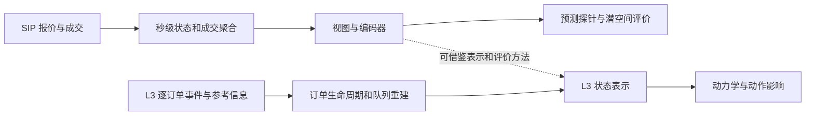

# TFWM v2 论文审查记录

审查日期：2026-10-22。范围：阶段一。原文为 [2610.09048v2.pdf](../2610.09048v2.pdf)，32 页，版本日期 2026-10-13。SHA-256 和代码版本见 [source_manifest.json](../results/source_manifest.json)。重点阅读正文第 1–10 页、附录 A/B 第 15–19 页、附录 C/D 第 20–25 页；第 6、18 页另渲染核对表格和评价设置。逐页提取文本和核对截图只作本地临时材料，不纳入 Git。

证据标签：**论文声明**表示原文报告；**代码核实**表示阅读固定版本实现；**本地实测**只用于实际运行结果；**我们的建议**表示面向 L3 的推断。论文中的数值不是本次复现成绩。

## 1. 论文实际贡献及边界

**论文声明：**贡献是 Market-1T 数据集、跨市场状态评价协议、18 种市场状态编码器的系统比较。18 种训练策略包括 4 个监督配置、5 个 LeJEPA 正样本构造和 9 个其他自监督配置；Random ViT 作为未训练基线，另比较冻结的时间序列基础模型。

论文第 3、10 页明确把工作定位在世界模型的状态表示层。其预测任务和潜空间分析不能证明已经完成订单生成、撮合、动作条件状态转移或交易冲击模拟。第 24–25 页的组合回测包含执行成本假设，也不能替代真实 L3 队列与撮合机制。

上半部分是本论文的主要实证范围；下半部分是我们项目需要另外建设的能力。图中下半部分没有在本轮实现。

## 2. 数据覆盖与字段

| 维度 | 论文声明 | 公开实现／资源核实 | 对 L3 的影响 |
| --- | --- | --- | --- |
| 来源 | Massive 提供 CTA/UTP SIP NBBO 与综合成交，2008–2025，接近一万亿秒级观测；第 4、15 页 | `market-1t` 读取 `quotes_v1`、`trades_v1`；完整构建需 Massive flat-file S3 访问 | 可以研究市场综合最优报价；没有逐订单 ID、队列和完整深度 |
| 频率 | 1 Hz；允许金融语义一致的粗化 | `snapshot.py` 按 SIP 时间聚合；稀疏行只在发生更新的区间保存 | 秒内事件顺序不可逆；不能从聚合数据恢复 L3 |
| 论文特征 | 报价价格／数量 4 列、OHLC+VWAP 5 列、volume/count 2 列，共 11 列；第 4、16 页 | 发布的 MDS/daystore 及 `MARKET_SCHEMA` 是 9 列，省略 open/close，VWAP 使用 `vwap_all` | 数据字典必须以具体版本和层次为准；不能把论文 11 列与输入信息 token 的 11 个数混同 |
| 模型额外信息 | 归一化四组 μ/σ、起止时间及聚合尺度，共 11 个数；第 18 页 | 默认 `info_norm_stats=True`、`info_window=True`；模型将其拆成信息 token | 9 个市场特征与 11 个视图信息值语义不同 |
| 公开子集 | 正文的大范围数据声明不等于完整文件都已发布 | HF 三布局卡片声明 2019-07–2020-12，376 个交易日、230,025 ticker-days | 跨长期市场状态的论文结论不能仅由此子集完整重现 |
| 交易时段 | 按交易日与市场日历构建 | dense/daystore 为常规时段；sparse 卡片为 07:00–20:00 ET | 模型配置支持扩展时段不代表公开 sparse 覆盖 04:00 起全部时段 |
| 宇宙选择 | 上月 common-stock 元数据和交易统计；均价 > $5、日均成交额 ≥ $20M、活跃秒占比 >20%；第 17 页 | 需要另外核对发布元数据与月度 membership 的可重建性 | 当前审查没有重算股票池，也没有证实完整原始参考数据可取得 |

## 3. 数据处理语义

**论文声明／代码核实：**

- 区间为 `(t−Δ,t]`，t 表示区间末端；报价取截至该时刻的最后状态，成交按适用条件聚合。
- `snapshot.py` 按 `(ticker, sip_timestamp, sequence_number)` 排序，报价数量由 round lot 转为股数（×100）。这一换算不能直接套用到新的 L3 源。
- `conditions.py` 和 `trade_conditions.json` 分别管理 OHLC、volume 的可用成交条件；Form T 在常规时段内的量、Stock Option 的价格资格等有专门规则。
- 原始 Parquet 存储字段多于模型字段，含 `vwap_all`、`vwap`、`vwap_ol`；不同 VWAP 资格集合不能静默互换。
- 无成交时量和笔数置零，状态／价格延续；有报价和成交之前的前导记录丢弃。稀疏数据再由 dataloader 重建稠密会话。
- `MARKET_SCHEMA` 将 bid/ask size 也列入 forward-fill；HF dense 卡片却概括为 sizes 零填。该描述差异必须用真实发布样本检验，不能仅凭文档断定发布数据有误。
- 新实现刻意保留 legacy pandas 数值行为：float64 区间运算可影响边界约 128ns 范围；部分 SIP 时间列经历 float64 往返后按约 256ns 粒度舍入；VWAP 使用补偿求和。这些是复现历史数据的约定，**我们的建议：**L3 主时钟、序列号、订单 ID 使用无损整数语义，另设兼容输出路径。
- 分区为 `polars.col('ticker').hash(42) % 100`；Polars hash 在较新版本发生变化，所以官方限制 `<1.26`，锁文件固定 1.6.0。升级依赖必须先验证分区与样本等价性。
- Market-1T 的按内存预算调度、断点续跑、原子写入可以借鉴；Windows 的内存检测和 RSS 回退需要单独审查。

## 4. 模型和训练

**论文声明：**ViT-S 作为公共骨干；代码默认 12 层、宽度 384、6 个注意力头、MLP 1536、patch 8。全局视图长度默认 2048，局部视图 512；具体方法的 overrides 仍需从配置或 checkpoint 元数据恢复。

监督学习使用同一交易日和时点的横截面股票组，以及 pairwise learning-to-rank；每个 cell 采样 16 只股票，batch 为 256 个 slots，训练 12 次遍历六个月窗口。自监督方法尽量匹配视图数量。五种正样本机制分别是同股不同裁剪、时间扭曲、噪声、跨股票和同业跨股票。增强鼓励的“不变性”不同，不能默认适合 L3 事件动力学。

**代码核实：**当前 `norm_mode='per_view'` 对每个输入窗口的四类特征计算自身均值和方差，size/volume/count 先 log1p；均值和尺度再随信息 token 输入。公开 supervised-spread 的 `train_meta.json` 也记录 `per_view`。这与第 5、17 页“由训练数据估计归一化统计”的笼统说法不完全一致。视图自身统计不自动意味着未来泄漏；关键是窗口是否只包含决策时点以前的信息。R0 的合成测试不能替代真实样本的窗口与标签时序核查。

代码另有 `event_predictor.py`：它将文本事件 embedding 加到预测头中，不是逐订单市场事件生成器，也不是动作条件环境。

## 5. 评价协议

| 项目 | 论文／固定代码的设置 | 审查结论 |
| --- | --- | --- |
| 时间划分 | 每个评价月以前六个月训练；另选五个调参月；正文声明 32 个月跨越完整历史 | 要保留月度 regime 多样性，不能把两天样本成绩等同论文 |
| 日期范围口径 | 论文正文／附录 B 概述为 2008–2025 内采样；当前 README 说主表 32 月为 2008–2023 | 应从结果文件实际 month 列确定；本轮记录该口径差异，未重建 R1 主表 |
| 目标 | 15 分钟后 return、volatility change、quoted-spread change | 都是预测目标；不直接测成交可达性、排队或动作冲击 |
| Return 定义 | `VWAP(t+900,t+960) / VWAP(t,t+60) − 1`，第 5 页 | 决策后 60 秒窗口，不能误换即时中间价收益 |
| 探针 | 冻结编码器；训练侧 ridge，按同一时点股票横截面算 Spearman IC 后汇总 | probe 拟合样本量显著影响成绩；需 full pool 公平比较 |
| 公开评分网格 | README：训练侧 36 anchors/day，评价侧 8 anchors/day | daystore 保存的 78 个五分钟 anchors 是数据容器；不能当作论文最终评分抽样数 |
| Readout | 预测用 last patch，潜空间用 mean；第 18 页及 checkpoint loader | 加载模型时要显式检查 pool，不能沿用任意默认值 |
| 基线 | Random ViT、经典金融模型、TSFM | 必须保留未训练和简单模型基线，SSL 不保证优于随机编码器 |
| 潜空间 | 相同视图、日期、股票、行业检索；因子载荷解码、子空间对齐；RankMe | 预测与组织结构是不同维度，不能单靠 IC 决定世界模型状态质量 |
| 统计 | 第 6 页：跨月变化远高于随机种子变化；图示 2SE 并对月份差异调整 | 不把单月或单次提升解释为跨 regime 优势 |
| 回测 | 2,448 个组合／执行配置；成本由 EFQ 等假设控制 | 只能作为下游鲁棒性观察；不表示拥有逐订单交互仿真 |

## 6. 论文结果解读

**论文声明（第 6 页表 2，已视觉核对）：**multihead 的 return/volatility/spread ridge IC 为 0.0311/0.0941/0.2455；spread specialist 的 spread IC 为 0.2517；Random ViT 为 0.0170/0.0694/0.1692。LeJEPA time-warp 为 0.0204/0.0721/0.1691，spread 未超过 Random ViT。

这些结果支持监督信号、未训练基线和跨月份评价的重要性。它们不能直接说明 SSL 对所有目标有效，也不能说明 L3 的额外信息一定提升模型。第 9–10 页给出的预测排名与组织排名相关系数约 −0.19，同样提示需要多维评价。

## 7. 面向 L3 的待补模块与待核验问题

**我们的建议：**新增源数据适配器，保存场所／instrument／订单 ID／原始整数时钟和序列；实现快照、重置、订单新增／修改／撤销／成交、状态恢复与质量标记；维护逐订单状态与队列；派生 L2 和场所 L1 后，才建立可比较的 TFWM 式聚合输入。动力学、动作空间、成交反馈和市场冲击评价后续单独设计。

尚未消除的问题：

1. 11 列论文数据与 9 列发布模型输入的选择过程，是否影响特定实验的可比性？
2. 发布 dense 文件的 size 填充值究竟是什么，是否与当前 `MARKET_SCHEMA` 一致？
3. `per_view` 的历史配置、可见窗口和信息 token 在所有公开 checkpoint 中是否一致？
4. 32 月结果的实际月份清单、调参月与评价月是否完全分离？
5. 原始完整宇宙元数据和成交条件规则的版本是否足以独立重建股票池？
6. HF `license: other / derived-market-data` 的具体授权文本尚未充分明确；MIT 代码许可不能直接扩展到数据和权重。
7. 本机 GPU 可见不代表 CUDA 张量、训练吞吐和显存已经验证。R3 应先小步测量，再估算完整训练。

这些问题均记录为待核验，没有因 R0 测试通过而自动关闭。
